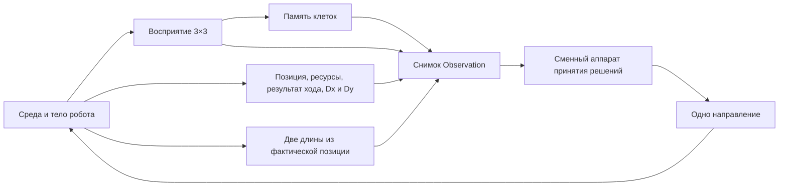

# Архитектура навигационного пилота

В базовом варианте A аппарат принятия решений получает снимок доступных сведений и возвращает одно из восьми направлений. Этот контракт реализуют дискретный автомат и табличная SARSA. SARSA сжимает карту в признаки каждого допустимого хода и выбирает ход по выученным оценкам. [Требования](project.md) · [Вход](decisions/0007-agent-map-and-service-distances.md) · [Кодирование SARSA](experiments/E-0001-sarsa.md)

## Вход аппарата принятия решений

`Controller.choose(view: Observation) → Move`. Один вызов соответствует одному решению. Координаты начинаются с (0, 0) в левом верхнем углу, x растёт вправо, y вниз. [Типы входа и действий](../maze/interface.py)

| Поле снимка | Что знает робот |
|---|---|
| `window` | Девять типов клеток вокруг фактической позиции, включая центральную клетку. За границей уровня видна стена. |
| `position`, `memory` | Позиция (x, y) и вся карта типов после записи текущего окна. Позиция передаётся отдельным полем. |
| `dx`, `dy` | Смещения до финиша B в клетках, `x_B − x` и `y_B − y`. |
| `fuel_distance`, `repair_distance` | Две длины кратчайшего пути из текущей позиции. Каждый минимум берётся по всем объектам своего типа. На сервисе длина равна 0, при отсутствии доступного объекта передаётся `None`. |
| `fuel`, `health` | Текущие запасы топлива и исправности после последней попытки хода и возможного обслуживания. |
| `last_move`, `moved` | Предыдущая команда и признак фактического перемещения. В начале эпизода оба поля равны `None`. |

У каждого запуска своя память. До первого наблюдения в ней отмечены все заправки F и мастерские R, остальные клетки неизвестны (`?`). Окно 3×3 обновляет типы в пределах поля, а ранее увиденные клетки за пределами окна сохраняются. Контроллер получает неизменяемый снимок. В пилоте карта хранит только типы клеток. [Память клеток](../maze/memory.py)

Среда заранее вычисляет два поля длин поиском в ширину по полной сети разрешённых дорог, отдельно от всех заправок и всех мастерских. Из каждого поля робот получает одно число для фактической позиции. Длины учитывают дороги к сервисам за пределами видимости. Расход ресурсов робот оценивает сам. Контракт исключает запросы из предполагаемой соседней позиции, которые дали бы подсказку направления. [Среда](../maze/environment.py) · [Основание ограничения](decisions/0006-baseline-a-and-rejected-b.md)

## Связь компонентов

### Порядок шага

1. При старте или после исполнения команды среда формирует окно, обновляет карту памяти и собирает снимок.
2. Контроллер выбирает направление. Базовый для сравнений frontier-reserve сначала ищет посильный путь по известным дорогам с возможными заездами на сервисы. Пока такого пути к финишу нет, использует разведку и наведение по фактическим показаниям датчиков. [Базовый автомат D-0010](decisions/0010-frontier-reserve.md) · [Ресурсный E-0002](experiments/E-0002-automaton.md#новые-правила) · [Архивный D-0008](decisions/0008-maze-pilot.md#переходы-автомата)
3. Среда проверяет ход и списывает по единице топлива и исправности за попытку. Длина разрешённого перехода равна 1, включая диагональ. Для диагонали обе боковые клетки должны быть проходимы. При столкновении робот остаётся на месте. При въезде на F топливо восстанавливается до 100, на R до 100 восстанавливается исправность. Это инженерные правила данного пилота. [Правила движения](../maze/grid.py)
4. Среда проверяет исход по порядку: достижение B, нулевое топливо, нулевая исправность, лимит ходов. Последней единицы хватает для въезда на финиш или на соответствующий сервис. Лимит по умолчанию равен `8 × ширина × высота`. Причина завершения хранится в `env.status`. [Шаг среды](../maze/environment.py)

Обычный запуск и графический просмотр вызывают один и тот же `advance`. Для замены автомата в `run` передают экземпляр контроллера, в `show` — фабрику. Просмотр может показать наблюдателю весь уровень. Цикл обучения использует `env.reset()` и `env.step(move)`, вычисляет награду и обновляет таблицу только на train. [Цикл исполнения](../maze/runner.py) · [SARSA](../maze/sarsa.py) · [Просмотр](../maze/viewer.py)

## Границы сравнения с RL

Доступ ко всей накопленной карте ранее обозначался C и входит в базовый A. Для проверки роли памяти нужны ситуации с одинаковыми остальными полями и разным содержимым карты. На фиксированном уровне таблица, учитывающая только позицию и ресурсы, может выучить маршрут по позиции. Первый пример с отдельными строками таблицы разобран в [расчёте SARSA](concepts/tabular-rl-at-a-fork.md).

Вариант D остаётся предметом обсуждения. В нём обучаемая часть выбирала бы одну из трёх потребностей, а заранее заданный поиск внутри аппарата принятия решений определял бы физический ход. Информационный доступ такого поиска нужно оговаривать отдельно. В действующем A контроллер сам выбирает одно из восьми направлений. [Разбор A и D](concepts/memory-and-decision-boundary.md)
