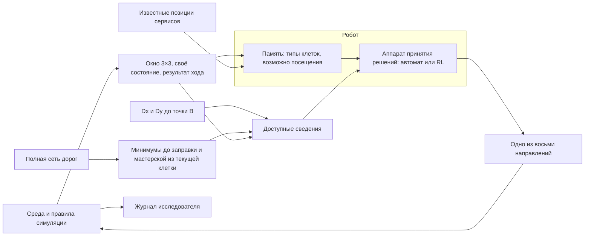

# Архитектура: среда, сведения, память и принятие решений

Обновлено 24.11.2026. Для базового A определены карта памяти и навигационные величины по [D-0007](decisions/0007-agent-map-and-service-distances.md). Уровень помощи и восемь действий заданы в [D-0006](decisions/0006-baseline-a-and-rejected-b.md). D обсуждается отдельно. Среда и автомат реализованы в [пилоте D-0008](decisions/0008-maze-pilot.md).

Подробности и примеры: [память и границы принятия решений](concepts/memory-and-decision-boundary.md). Требования: [project.md](project.md). История вариантов: [simulation-options.md](concepts/simulation-options.md).

## Вход аппарата принятия решений

На каждом шаге оба контроллера получают одинаково устроенные сведения. Предлагаемый формат размещает метку текущей клетки и известные положения всех сервисов в тех же координатах, что и карту памяти.

| Поле | Содержание к моменту выбора хода |
|---|---|
| Текущее восприятие | Видимые типы клеток в окне 3×3 вокруг агента |
| Собственное состояние и обратная связь | Остаток топлива, исправность, фактический результат предыдущего движения |
| Карта памяти `M_t` | Вся накопленная карта типов после записи текущего наблюдения, с привязкой к текущей клетке |
| `Dx`, `Dy` | Смещения в клетках от агента до точки назначения B: `x_B − x_t` и `y_B − y_t`. Знак указывает сторону по соответствующей оси |
| `L_fuel` | Минимальная длина разрешённого пути из текущей клетки до любой заправки |
| `L_repair` | Минимальная длина разрешённого пути из текущей клетки до любой мастерской |

**Как агент заполняет карту.** Предлагаемый начальный вид карты содержит отметки заранее известных заправок и мастерских. Остальные клетки имеют значение «неизвестно» до первого наблюдения. Перед выбором хода агент совмещает окно 3×3 с картой по своему фактическому положению и записывает тип каждой видимой клетки. Клетки за пределами окна сохраняют прежние значения. Так агент запоминает и дорогу, которую видел сбоку, даже если ещё по ней не ехал. Метка «я здесь» указывает положение в момент решения и перемещается только при состоявшемся ходе. В пилоте локализация точная, x растёт вправо, y вниз. Число посещений остаётся возможным дополнением.

**Как вычисляются два минимума.** Для фактической текущей клетки `p` и объекта `s` обозначим через `d(p,s)` длину кратчайшего пути по полной сети дорог с учётом препятствий и правил движения. Расчётчик берёт минимум `d(p,s)` отдельно среди заправок и среди мастерских. Сервис за пределами исследованной области тоже участвует. При равных длинах передаётся их общее значение, на клетке сервиса соответствующее значение равно нулю. Если пути нет ни к одному объекту данного типа, предлагаем передавать «недостижимо». В пилоте все разрешённые ходы дают единичную длину, отсутствие пути обозначено `None`. Топливо и исправность агент сопоставляет с длинами отдельно.

## Связь компонентов

Автомат и RL сравниваются в отдельных запусках. В одинаковом состоянии им доступны одинаковые сведения и один набор физических действий. «Общий модуль» означает одинаковую программу, а не общую изменяемую память двух запусков.

Полная сеть дорог у расчётчика длин и накопленная карта робота — разные источники. Первая разрешена как предварительное знание для A. Вторая обновляется из наблюдений и известных положений сервисов.

## Границы компонентов

| Компонент | Ответственность | Что он не подменяет |
|---|---|---|
| Окружение | Дороги, препятствия, сервисы и условия взаимодействия | Выбор потребности и направления |
| Симулятор | Исполнить физическую команду; обновить положение, топливо, исправность, обслуживание и завершение | Не выбирает «правильное» направление вместо полученного |
| Наблюдение | Окно 3×3, доступное собственное состояние и результат команды | Не раскрывает истинные типы всей карты |
| Расчёт длин A | По полной разрешённой сети сообщает длины до объектов из фактической текущей позиции | Не выдаёт путь, следующую команду или длины из воображаемых соседей |
| Память робота | Сохраняет типы клеток и, если выбраны, посещения | Не хранит историю переходов, маршруты, времена и метки тупиков |
| Представление входа | Передаёт наблюдение, известные положения, длины и разрешённый доступ к памяти | Получить поле карты не означает реально использовать его |
| Аппарат принятия решений | По доступным сведениям выбирает направление; реализуется автоматом или RL | Его вычисления не объявляются внешними событиями среды |
| Обучение и оценка | Обновление параметров RL, сбор диагностик и сравнение | Журнал исследователя не становится памятью действующего робота |

Окружение и вход робота — не синонимы. Вход включает собственное состояние, заданные сведения о сервисах и результат расчёта длин. Топливо и исправность относятся к телу робота, хотя симулятор хранит их значения и рассчитывает изменения.

Размещение расчётчика длин внутри программной обёртки или рядом с роботом не меняет разрешённую информацию A. Важно, что он только сообщает длины из текущей позиции. Возможность опросить полную сеть о каждом гипотетическом следующем положении восстановила бы отвергнутый B.

## Как аппарат принятия решений читает карту

Доступ ко всей накопленной карте ранее обозначался C. По D-0007 карта подаётся на вход при каждом выборе направления в базовом A.

Предложенная реализация автомата: режимы выбора задачи и алгоритм поиска по собственной карте. Временные рабочие данные поиска не сохраняются между ходами. Поиск не получает скрытого доступа к полной сети расчётчика длин.

Для первого опыта сохраняется табличный RL. Если ключ таблицы содержит только позицию, топливо и исправность, выбор действия не зависит от содержимого карты. Предстоит выбрать, как учитывать карту в ключе, и оценить число возможных состояний на фиксированном поле.

Для малого поля предложен ключ со снимком карты. [Пример развилки](concepts/tabular-rl-at-a-fork.md) показывает на одних и тех же проходах, какие строки получает SARSA с таким ключом и при исключении карты.

## Где находится навигатор в D

D остаётся обсуждаемой альтернативой. В его аппарате принятия решений последовательно работают:

1. Автомат или RL выбирает потребность: B, топливо либо ремонт.
2. Заранее написанный поиск выбирает сервис и физическое направление.
3. В среду отправляется это направление; среда исполняет его обычным образом.

Поиск, выбирающий ход, относится к управлению роботом. Использование одинакового поиска двумя реализациями не превращает его в окружение.

При этом RL-компонент D обучается выбирать только три потребности. При фиксированном разрешении равенств ему доступны не более трёх направлений, получаемых от поиска для данной ситуации, иногда меньше. Размещение поиска внутри робота не даёт RL свободу выбрать любой из восьми допустимых ходов. Такую систему следует описывать как обучаемую часть вместе с заранее написанной частью принятия решений.

Полная сеть у поиска D была разрешена в прежнем обсуждении. Её нельзя незаметно приравнять к наблюдению 3×3 или памяти. Если вместо полной сети использовать накопленную карту, это отдельное изменение условий D.

## Какие детали ещё открыты

Пилот фиксирует восьмисвязную статическую сетку, окно с постоянной ориентацией, точную позицию, метки сервисов, единичную длину хода и отдельное завершение по лимиту. Для RL ещё предстоит выбрать награду и табличное представление памяти. Правила пилота и порядок разрешения одновременных событий собраны в [D-0008](decisions/0008-maze-pilot.md).

## Предлагаемый порядок шага

1. Сформировать наблюдение и результаты предыдущего физического действия.
2. Обновить память разрешёнными сведениями.
3. Получить длины A для фактической позиции; сформировать вход аппарата принятия решений.
4. Автомат или RL выбирает физическое направление.
5. Симулятор исполняет команду, рассчитывает последствия и данные для обучения/оценки.

Пилот исполняет движение, списывает ресурсы, обслуживает робота при въезде и определяет исход. Завершение самой задачи и ограничение длительности запуска следует различать.

## Инварианты сравнения

- Равны доступные сведения и допустимые физические действия; собственные вычисления методов могут различаться.
- Среда не переписывает выбранный ход в оптимальный.
- Неизвестность клетки не означает доказанную непроходимость.
- В A нет запросов длин из гипотетических соседних позиций, раскрывающих B.
- Анализ собственной карты разрешён; подмена её истинной картой через вспомогательный поиск не разрешена.
- Счётчики не гарантируют отсутствия циклов и не запрещают необходимые возвраты.
- Известная кратчайшая дорога не гарантирует достаточности топлива и исправности.
- Успех таблицы на одной карте не доказывает использования памяти или переноса на другие карты.

[Среда](../maze/environment.py) и [память клеток](../maze/memory.py) формируют неизменяемый [вход контроллера](../maze/interface.py). [Автомат](../maze/automaton.py) получает только этот вход. [Цикл исполнения](../maze/runner.py) принимает сменный контроллер. [Просмотр](../maze/viewer.py) вызывает тот же шаг по таймеру.
