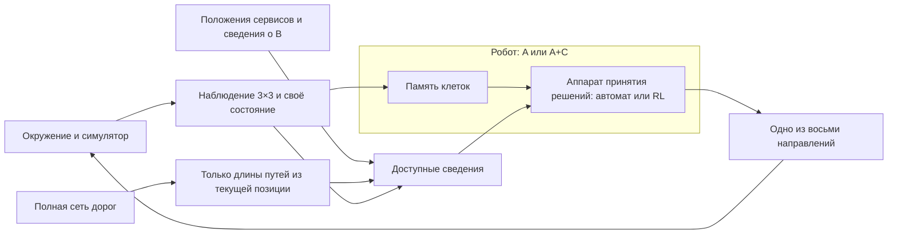

# Память C и граница между средой и принятием решений

Обновлено: 04.10.2026. Основание: пользователь отклонил B, выбрал A для первых опытов и попросил подробнее объяснить C и D. Решение о A/B: [D-0006](../decisions/0006-baseline-a-and-rejected-b.md). Ниже сохранены предложения, обсуждавшиеся до реализации.

Уточнение от 24.11.2026. Вся накопленная карта входит в текущий интерфейс по [D-0007](../decisions/0007-agent-map-and-service-distances.md). Пилот автомата описан в [D-0008](../decisions/0008-maze-pilot.md).

## Выбор на 04.10.2026 и поправка к прежнему сравнению

**A — базовый вариант. B отклонён. C подробно рассматриваем как способ использовать память. D обсуждаем после разъяснения его устройства.**

Прежний список смешивал разные вопросы. A определяет, какую помощь с дорогой получает аппарат принятия решений. C определяет, какую часть накопленной памяти он может использовать. Поэтому осмысленное сочетание — **A+C**: длины путей из текущей позиции плюс вся накопленная карта; одно из восьми направлений выбирает сам аппарат принятия решений.

D отвечает на третий вопрос: какая часть принятия решений задаётся правилами и поиском пути, а какая обучается. Он не является просто ещё одним способом передать наблюдение.

## Окружение, входные сведения и внутренние части робота

Все сведения на входе робота нельзя называть окружением: среди них есть его собственное состояние и заранее предоставленные знания.

| Часть | Что к ней относится | Что она делает |
|---|---|---|
| Окружение | Дороги, препятствия, заправки, мастерские и условия взаимодействия с ними | Определяет, что существует и где можно двигаться |
| Симулятор | Правила перемещения, расхода, обслуживания и завершения; фактическое положение и показатели робота | Исполняет выбранный физический ход и вычисляет последствия |
| Наблюдение | Матрица 3×3, топливо, исправность, результат действия; положение, если принимаем точную локализацию | Сообщает роботу доступное текущее состояние |
| Предоставленные сведения | Положения всех сервисов, информация о B в выбранном виде, длины путей из текущей позиции в A | Дополняют наблюдение по явно согласованным правилам |
| Память робота | Типы клеток и, возможно, посещения | Сохраняет разрешённые сведения между ходами |
| Аппарат принятия решений | Правила автомата либо обучаемый выбор RL; включённые в него вычисления по доступным данным | Выбирает действие робота |
| Журнал исследования | Полная траектория, истинная карта и диагностические результаты | Нужен исследователю, не является дополнительной памятью робота |

При реализации симулятор хранит также внутренние показатели тела робота, чтобы правильно их изменять. Это не делает их показателями внешней дороги: робот узнаёт собственные топливо и исправность через внутреннее наблюдение.

В A и A+C симулятор получает команду вроде «вверх-вправо». Он проверяет возможность этого перемещения и вычисляет последствия. Если движение запрещено, результат определяется одинаковыми правилами среды. Симулятор не заменяет выбранный ход на «правильный путь к заправке».



Расположение функции расчёта длин в файлах программы не определяет её научную роль. В A она предоставляет одинаковые сведения двум реализациям; она не выбирает исполняемый ход. Полная сеть дорог разрешена этому расчёту отдельно от накопленной памяти.

**Ограничение после отказа от B:** длины сообщаются для текущего фактического положения. Запросы вида «а сколько было бы из этой соседней клетки?» к полной сети не входят в A: перебором восьми соседей можно было бы восстановить отвергнутый B. Это не запрещает роботу самостоятельно рассуждать по своей накопленной карте.

## C: что именно хранится в памяти

Логически это две таблицы с одинаковыми координатами, вторая необязательна:

```text
types[y, x]  — неизвестно / препятствие / дорога / заправка / мастерская
visits[y, x] — число фактических входов в клетку, если используем посещения
```

Тип и посещение отвечают на разные вопросы. Робот может увидеть дорогу рядом и записать её тип, ни разу не въехав на неё: тогда тип известен, а число посещений равно нулю. Неизвестная клетка тоже может иметь нулевое число посещений; её отличает именно тип «неизвестно».

Для привязки окна 3×3 к таблице нужно знать, к каким клеткам относятся наблюдения. Точная позиция — предложенное упрощение первого опыта. Новые поля для истории перемещений ради этого не добавляются.

Предлагаемый порядок обновления:

1. Перед первым ходом типы ещё не наблюдавшихся клеток неизвестны. Положения сервисов можно отметить из заранее известного списка.
2. После наблюдения вписать типы девяти доступных клеток в нужные места таблицы.
3. Если робот фактически вошёл в другую клетку, увеличить только её посещения. Смотреть на клетку и пытаться безуспешно войти в неё — не посещение.
4. На следующем шаге сохранить остальную таблицу. Между независимыми запусками очистить память по выбранному правилу.

В память не добавляются отметки тупиков, списки маршрутов, времена наблюдения или история переходов. Стартовое посещение и точное/ограниченное хранение чисел остаются деталями спецификации.

## Что даёт вся карта по сравнению с ближайшими клетками

Представим развилку: раньше робот исследовал левую дорогу, увидел её закрытый конец и вернулся. Сейчас закрытого конца в окне 3×3 уже нет. Если аппарату передаётся вся карта C, известные клетки этого участка всё ещё доступны.

Автомат может заново проверить, есть ли в этом известном участке выход к выбранной цели или ещё неисследованным местам. RL может использовать ту же картину при выборе направления, если его способ обработки входа действительно учитывает карту. Отдельная запись «слева тупик» для этого не нужна.

При неполных наблюдениях отсутствие известного выхода ещё не доказывает, что выхода нет в мире. «Неизвестно» нельзя превращать в «препятствие». Карту типов нужно интерпретировать вместе с этой неопределённостью.

Если передавать только типы ближайших 3×3 клеток, уже полностью видимых датчиком, память типов почти ничего не добавляет к текущему наблюдению. Посещения этих клеток всё же несут новые сведения. Чтобы учитывать ранее увиденную далёкую дорогу, нужен доступ к соответствующей части карты, а не только её хранение.

## C для дискретного автомата

Предлагаемый аппарат состоит из **режимов управления и алгоритма работы с картой**. Поиск пути здесь — его собственное вычисление, а не направление, полученное от среды.

1. Правила по внутренним показателям и длинам путей A выбирают текущую задачу: B, топливо или ремонт.
2. Если нужно обслуживание, правила выбирают сервис, учитывая длины путей. Простой исходный вариант — ближайший подходящего типа; порядок ремонта и заправки всё равно требует правил.
3. По накопленной карте ищется дорога к этой цели через известные проходимые клетки. Алгоритм использует только разрешённую память; скрыто читать полную карту расчётчика длин нельзя.
4. Если известной непрерывной дороги нет, нужно правило исследования. Предложение: найти доступное по известной дороге место, откуда можно увидеть ещё неизвестные клетки, и выбрать ближайший ход к нему.
5. В среду передаётся одно из восьми направлений.

Такие места исследования можно вычислять по типам клеток перед решением и затем забывать. Рабочая очередь поиска и найденный в этом вычислении путь также не сохраняются между ходами. Память остаётся прежней.

Посещения могут помогать выбирать между равноценными вариантами. Делать из них запрет повторного входа нельзя: для выхода из тупика возврат бывает необходим. Конкретное правило не должно незаметно менять кратчайший путь, если в данном опыте требуется именно он.

Это реализуемый расширенный автомат с памятью и поиском. Три названия режимов сами по себе его полностью не описывают. В этой версии концепта алгоритм исследования и приоритеты были предложениями.

## C для RL

RL получает те же исходные сведения, что автомат: наблюдение, внутренние показатели, положения сервисов, длины путей A, позицию в выбранном виде и карту памяти. Выход остаётся одним из восьми направлений. Между выбором RL и исполнением нет модуля, заменяющего его решение на кратчайший ход.

Есть три разных по смыслу способа начать:

| Способ | Реальное использование памяти | Ограничение |
|---|---|---|
| Прежняя таблица по позиции, топливу и исправности | Карта памяти не участвует в выборе | Это базовый A, а не проверка C |
| Добавить в табличное описание ситуации всю карту типов и посещений | Каждая отличающаяся запись памяти может стать другой ситуацией для таблицы | Очень много сочетаний и редко повторяющихся записей; годится только для отдельно ограниченного малого опыта |
| Обрабатывать всю карту нерекуррентной нейросетью | По всей текущей записи памяти выбирается направление | Нужны обучение и отдельная проверка того, что карта действительно используется; это ещё не выбранный метод |

В третьем способе типы можно подать несколькими таблицами «здесь дорога», «здесь препятствие», «здесь неизвестно» и так далее; посещения — ещё одной таблицей. Это разные способы представить те же два разрешённых поля, а не новые записи памяти. Положение робота и известные сервисы также можно показать на входе по уже доступным координатам.

Нейросеть каждый раз читает текущую карту. Скрытое состояние, которое переносилось бы между шагами вместо разрешённой памяти клеток, не предлагается. Обученные параметры сохраняются между обучающими запусками как результат обучения — так же, как значения таблицы Q.

Небольшой участок карты позволяет отдельно проверить использование локальной памяти. Ограниченные значения посещений могут упростить представление и при передаче всей карты: тогда уменьшается точность счётчиков, но полный пространственный доступ C сохраняется. Эти ограничения различаются. Передать полную карту в объект входа, а затем игнорировать её при выборе — недостаточно для заявления, что RL работает с полной памятью.

Таким образом, первый выбранный A с табличным RL менять не нужно. Для настоящего опыта C позже потребуется отдельный выбор представления карты. Возможность подать таблицы нейросети не является доказательством, что она научится искать пути или избегать повторений.

## Одинаковые сведения не означают одинаковые вычисления

В A+C автомат может выполнять заранее написанный поиск по памяти, а RL — выбирать ход по обученным правилам. Это разные способы принятия решений над одинаковыми сведениями, что и нужно явно описывать в сравнении.

Если перед выбором обоим методам выдавать уже рассчитанные направления или длины из соседних клеток по полной сети, это было бы возвращением B. Если готовый поиск после выбора потребности обязательным образом задаёт ход RL, это устройство D. Общая память сама по себе ни B, ни D не требует.

## D: навигатор является частью принятия решений

Прежнее выражение «общий навигатор» было недостаточно точным. Общий программный модуль не становится частью окружения только потому, что используется в обеих реализациях.

В D внутри робота находятся две последовательно работающие части:

```text
Сведения + память
    → автомат или RL выбирает «к B / топливо / ремонт»
    → заранее написанный поиск выбирает сервис и физический ход
    → среда исполняет полученное направление
```

Обе первые операции относятся к аппарату принятия решений. Для варианта с автоматом это «автомат выбора потребности + поиск пути». Для варианта с RL — «обучаемый выбор потребности + тот же заранее написанный поиск». Среда у них одна и принимает физическое направление.

Но **ограничение RL от этого не исчезает**. В данной ситуации навигатор может предложить ход к B, ход к заправке и ход к мастерской. При фиксированном выборе между равными маршрутами RL доступны не более трёх этих направлений, иногда они совпадают. Иной допустимый ход может вообще не выбираться ни одной из трёх потребностей.

Например, RL мог бы захотеть сделать шаг к неисследованному участку дороги. Если ни один из трёх вариантов навигатора туда не ведёт, выразить такой выбор через «к B / топливо / ремонт» невозможно. Также RL не выбирает конкретную более далёкую заправку, если готовый поиск всегда назначает ближайшую.

Следовательно, в D обучается выбор потребности, а остальная часть движения уже написана программистом. Это содержательное ограничение возможного поведения. Перенос кода навигатора из среды внутрь робота только делает границу честной, но не превращает три решения в восемь свободных направлений.

Формально для отдельного обучаемого компонента результат решения зависит и от этого готового поиска. Поэтому при описании RL необходимо учитывать весь путь от выбранной потребности до физического перехода. Объявить поиск «внутри робота» и перестать учитывать его влияние нельзя.

Для такого D ранее была разрешена полная сеть дорог у поиска. Это дополнительное предварительное знание должно оставаться явным и одинаковым для двух реализаций. Если вместо него дать поиску только накопленную карту, это уже изменение информационного условия, а не перестановка программных модулей.

## Последствия для следующего шага

A остаётся базовым первым опытом: одинаковые сведения, самостоятельное решение о каждом направлении. C можно развивать поверх него, передавая обоим методам полную накопленную память. B исключён; D разъяснён и не подменяет выбранный A.

Для дальнейшего сравнения остаётся выбрать обработку карты в табличном RL. При проверке памяти важно сопоставлять варианты, которые действительно используют или исключают соответствующие поля, и не менять ради желаемого результата саму задачу или награду.
